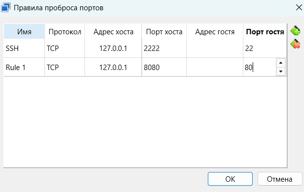
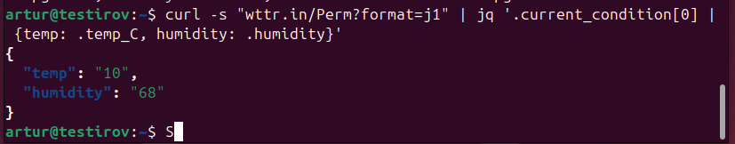
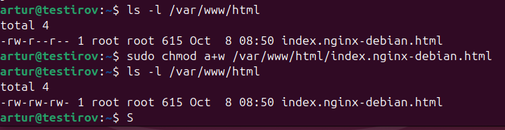
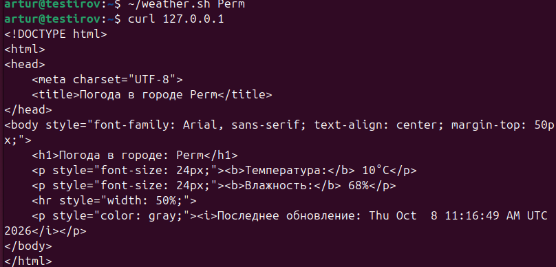
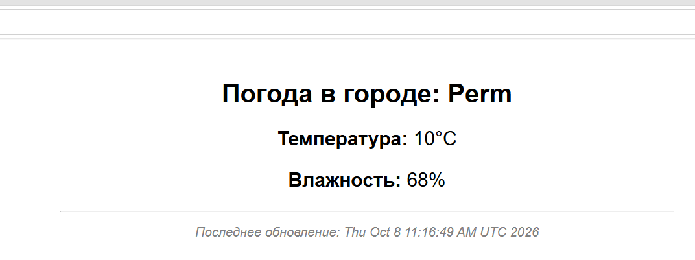
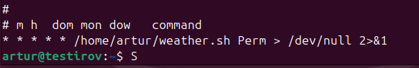

# Практическая работа №2: Автоматизация в Linux (Bash, Nginx, Cron)

## Выполнил: [Ваше ФИО]

### Шаг 1. Установка веб-сервера Nginx и публикация порта
- На виртуальной машине установлен веб-сервер Nginx: `sudo apt install nginx -y`.
- В настройках сетевого адаптера VirtualBox (режим NAT) добавлен проброс порта: порт `8080` хостовой системы перенаправлен на стандартный HTTP-порт `80` гостевой системы.
- Работоспособность веб-сервера проверена открытием страницы `http://127.0.0.1:8080` в браузере хостовой системы.

### Шаг 2. Получение данных о погоде и парсинг JSON
- Изучен формат ответа сервиса `wttr.in` в формате JSON (`?format=j1`).
- Установлена консольная утилита для обработки JSON-данных: `sudo apt install jq -y`.
- Протестирована фильтрация данных: извлечение полей `temp_C` (температура) и `humidity` (влажность) из массива `current_condition`.

### Шаг 3. Подготовка прав доступа и разработка Bash-скрипта
- Для индексного файла веб-сервера `/var/www/html/index.nginx-debian.html` установлены права на запись для всех пользователей: `sudo chmod a+w ...`.
- Разработан скрипт `weather.sh`, который:
  1. Принимает название города в качестве входного позиционного аргумента (`$1`).
  2. Запрашивает метеоданные через API сервиса `wttr.in`.
  3. Извлекает поля температуры и влажности с помощью утилиты `jq`.
  4. Генерирует HTML-страницу и сохраняет её в директорию Nginx с фиксацией времени обновления.
- Скрипт наделен правами на исполнение (`chmod +x ~/weather.sh`) и протестирован вручную.

### Шаг 4. Автоматизация запуска по расписанию через Cron
- В планировщик задач `cron` текущего пользователя добавлено задание:
  `* * * * * /home/runner/weather.sh Perm > /dev/null 2>&1`
- Данное расписание обеспечивает выполнение скрипта каждую минуту с подавлением стандартного вывода и ошибок.
- Настройка проверена командой `crontab -l`.
- Корректность работы подтверждена автоматическим обновлением метки времени и данных о погоде на веб-странице в браузере.

